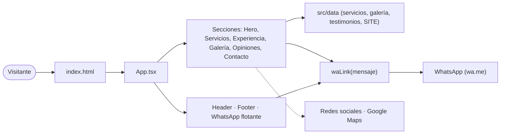
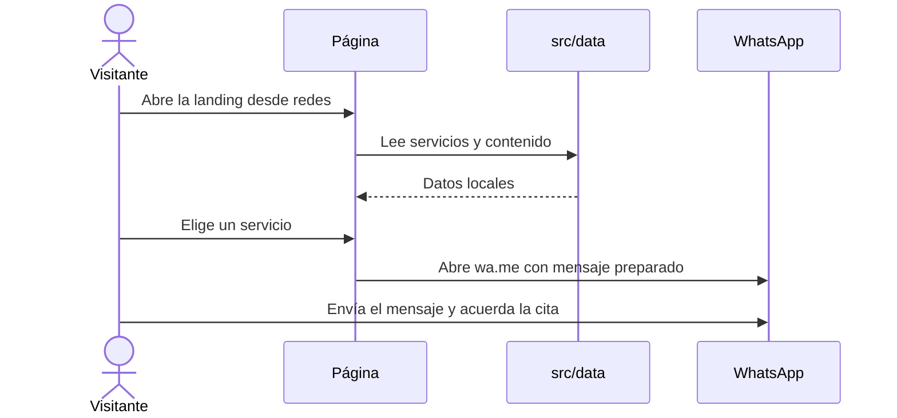

<div align="center">

<br/>
**Página de servicios de peluquería canina y petshop, pensada para que cada visita termine en una consulta por WhatsApp.**
<br/>


<br/>


</div>


##  Contenido

[El problema](#-el-problema) · [La solución](#-la-solución) · [Funcionalidades](#-funcionalidades) · [Arquitectura](#-arquitectura) · [Flujos de trabajo](#-flujos-de-trabajo) · [Criterios y decisiones](#-criterios-y-decisiones) · [Stack](#-stack) · [Estructura del repo](#-estructura-del-repo) · [Puesta en marcha](#-puesta-en-marcha) · [Pruebas y calidad](#-pruebas-y-calidad) · [Seguridad](#-seguridad) · [Despliegue](#-despliegue) · [Estado y pendientes](#-estado-y-pendientes) · [Licencia](#-licencia-y-autoría)


##  El problema

Quien busca peluquería para su perro llega desde redes sociales y necesita, en pocos segundos, entender qué servicios hay, cómo es la atención y cómo pedir una cita. Sin una página ordenada, la consulta se pierde entre publicaciones y mensajes sueltos.

##  La solución

Wasi Pet es una landing de una sola página para la peluquería canina y el petshop de Cochabamba. Presenta:

- los servicios, con un mensaje de WhatsApp preparado para cada uno;
- el proceso de atención en cuatro pasos;
- la galería, los testimonios y la sección de petshop;
- los canales de contacto, redes y Google Maps.

La página no registra reservas ni confirma horarios: la cita se cierra en la conversación de WhatsApp.


##  Funcionalidades

<details open>
<summary><b>Oferta y consulta</b></summary>

- Tarjetas de servicios destacadas, cada una con su consulta de WhatsApp.
- Sección de petshop con categorías de productos y consultas de disponibilidad.
- Botón flotante de WhatsApp que aparece al desplazarse.
</details>

<details open>
<summary><b>Experiencia de navegación</b></summary>

- Navegación por anclas, menú móvil y resaltado de la sección visible.
- Barra de progreso de lectura.
- Animaciones de entrada, parallax y tarjetas con inclinación según el puntero.
- Galería responsive y testimonios.
</details>

<details>
<summary><b>Accesibilidad y SEO</b></summary>

- Enlace para saltar al contenido, estilos de foco y etiquetas ARIA.
- Ajustes para movimiento reducido en CSS y en los componentes de animación.
- Metadatos de descripción, Open Graph, Twitter Card y datos estructurados `LocalBusiness`.
</details>


##  Arquitectura

Aplicación de una sola página renderizada en el navegador. Vite genera archivos estáticos; `App.tsx` compone el encabezado, las secciones, el pie y el acceso flotante a WhatsApp. La navegación usa anclas del documento, sin router.

<div align="center">

</div>




##  Flujos de trabajo

Desde la visita hasta la consulta:




##  Criterios y decisiones

| Decisión | Por qué |
|---|---|
| Landing estática con Vite, sin backend | El objetivo es presentar y derivar la consulta; no hay reservas que guardar. |
| Contenido en módulos TypeScript (`src/data`) | Se edita sin tocar componentes; los tipos ayudan en la compilación. |
| Consultas por `wa.me` con mensaje codificado | Cada servicio abre una conversación con contexto, sin integrar una API. |
| Animaciones con Framer Motion y CSS | Efectos de entrada y movimiento, respetando la preferencia de movimiento reducido. |


##  Stack

| Capa | Tecnología | Versión (`package.json`) |
|---|---|---|
| Interfaz | React, React DOM | ^19.2.0 |
| Lenguaje | TypeScript | ~5.9.0 |
| Empaquetado | Vite, @vitejs/plugin-react | ^7.0.0 · ^5.0.0 |
| Estilos | Tailwind CSS (`@tailwindcss/vite`) | ^4.3.0 |
| Animación | Framer Motion | ^12.40.0 |
| Iconos | Lucide React | ^1.17.0 |
| Backend, base de datos, contenedores | No aplica | — |


##  Estructura del repo

```text
src/
├── App.tsx             # composición de la página
├── data/               # servicios, galería, testimonios y datos de contacto (SITE)
├── components/
│   ├── layout/         # Header, Footer
│   ├── sections/       # Hero, Services, Experience, Gallery, Testimonials, Petshop, FinalCTA…
│   └── ui/             # botones, logo SVG, tarjetas con inclinación, WhatsApp flotante
└── styles/globals.css  # tokens y estilos
public/                 # favicon
index.html              # documento base y metadatos
DESIGN.md · PRODUCT.md  # intención visual y contexto del producto
```


##  Puesta en marcha

**Requisitos:** Node.js compatible con Vite 7 (`^20.19.0 || >=22.12.0`) y npm. El repositorio no fija versión con `.nvmrc`.

```bash
npm ci
npm run dev       # http://localhost:5173
npm run build     # tsc && vite build → dist/
npm run preview   # sirve la compilación local
```

No se requieren variables de entorno, base de datos ni servicios externos para desarrollar. El contenido se edita en `src/data/`; las categorías del petshop están en `Petshop.tsx`.


##  Pruebas y calidad

- El repositorio no contiene pruebas automatizadas.
- La verificación automática disponible es la compilación con chequeo de tipos (`npm run build`). No se ejecutó en esta revisión.
- Revisión manual recomendada: menú móvil, botón de WhatsApp en distintos anchos y enlaces de consulta.


##  Seguridad

- Enlaces externos a WhatsApp, redes y mapas; el mensaje de cada consulta se codifica con `encodeURIComponent`.
- No hay formularios, ni cuentas, ni datos personales almacenados por la página.
- Los testimonios y fotografías son referenciales; su autenticidad no se verifica desde el código.


##  Despliegue

- La salida de `npm run build` es estática (`dist/`) y puede servirse desde cualquier alojamiento de archivos.
- No se documentan proveedor de alojamiento, dominio, Docker ni CI/CD.


##  Estado y pendientes

- **Versión 1.0** (último commit del 2026-06-10: «Version 1.0 - Landing page Wasi Pet»).
- Pendiente: retirar del `index.html` el script temporal de captura de Figma, según su propio comentario.
- Pendiente: agregar el metadato `canonical`, que no aparece en `index.html`.
- Pendiente: verificar testimonios y fotografías antes de publicarlos como reales.


##  Licencia y autoría

Desarrollado por el **Ing. Santiago Abasto**.


No se encontró archivo de licencia en el repositorio. Uso y distribución: a definir por el titular del proyecto.
